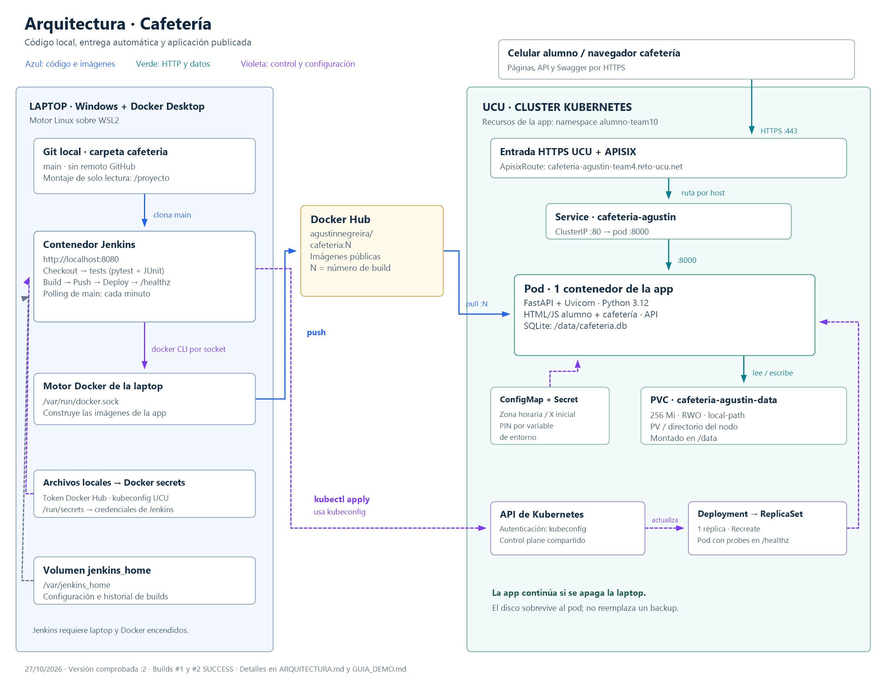

> **Actualización 04/11/2026:** el entregable 3 usa el laboratorio local, con Jenkins autenticado, kind, Kyverno y Falco. Ver [informe](ENTREGABLE_3.md) y [guía vigente](GUIA_ENTREGABLE_3.md). El contenido inferior conserva el historial anterior; las menciones a pendientes, falta de remoto o despliegue automático UCU son históricas.

# Arquitectura de Cafetería

Estado verificado: 27/10/2026. Código local en la carpeta cafeteria, rama main, sin remoto GitHub. Imagen actual agustinnegreira/cafeteria:2; Jenkins local y app en Kubernetes UCU. La guía de uso está en [GUIA_DEMO.md](GUIA_DEMO.md).

## 1. Vista general

El diagrama también está en [SVG ampliable](docs/arquitectura.svg). Se genera con [este script](docs/generar-arquitectura.ps1).

Hay dos procesos relacionados: **servir pedidos a los usuarios** y **entregar una versión nueva de la aplicación**. La app publicada funciona aunque apagues la laptop. La laptop es necesaria para que Jenkins procese nuevos commits.

## 2. Dónde corre cada componente

| Lugar | Componentes | Responsabilidad |
|---|---|---|
| Navegador o celular | HTML, CSS, JavaScript y localStorage | Interfaz de alumno o cafetería y solicitudes HTTP |
| Disco Windows | Git local, código, kubeconfig y archivo del token | Fuentes y configuración de acceso |
| Docker Desktop / WSL2 | Motor Docker y contenedor jenkins-cafeteria | Ejecutar Jenkins y construir imágenes |
| Dentro de Jenkins | Java/Jenkins, Git, Python/venv/pytest, docker-cli y kubectl | Ejecutar el pipeline |
| Volumen Docker local jenkins_home | /var/jenkins_home | Configuración, historial y espacios de trabajo de Jenkins |
| Docker Hub | agustinnegreira/cafeteria:1, :2, :N | Distribuir imágenes versionadas |
| Infraestructura de entrada UCU | HTTPS/proxy y APISIX | Recibir el tráfico público y encaminarlo por host |
| Cluster UCU | API/controladores, nodos y recursos de nuestra app | Mantener y ejecutar el despliegue |
| Namespace alumno-team10 | Deployment, ReplicaSet, pod, Service, PVC, ConfigMap, Secret y ApisixRoute propios | Recursos del proyecto en un espacio compartido |
| Contenedor de la app | Python 3.12, Uvicorn, FastAPI y SQLite | Servir páginas/API y aplicar las reglas |
| Almacenamiento del nodo | PV creado por local-path, solicitado con el PVC | Conservar el archivo SQLite al reemplazar el pod |

El host público incluye team4 por la convención usada al crearlo; **el namespace real es alumno-team10**. Los recursos propios llevan owner: agustin. No hay un Jenkins instalado en el cluster.

## 3. Qué pasa cuando un alumno hace un pedido

~~~mermaid
flowchart TD
    B["Navegador / celular HTML + CSS + JavaScript"]
    E["Entrada HTTPS de la UCU"]
    A["APISIX regla ApisixRoute por hostname"]
    S["Service cafeteria-agustin ClusterIP :80"]
    P["Pod: 1 contenedor Uvicorn + FastAPI :8000"]
    DB["SQLite /data/cafeteria.db"]
    V["PVC 256 Mi → PV local-path almacenamiento del nodo"]
    C["ConfigMap + Secret variables del proceso"]
    D["Deployment → ReplicaSet mantiene 1 réplica"]
    B -->|"GET páginas / POST API"| E
    E --> A
    A --> S
    S --> P
    P --> DB
    DB --> V
    C -.->|"al crear el pod"| P
    D -.->|"gestiona"| P
~~~

1. El DNS resuelve el hostname público de la UCU. El navegador accede por HTTPS.
2. La infraestructura compartida recibe la conexión. APISIX encuentra la ApisixRoute cuyo host coincide.
3. La ruta apunta al Service cafeteria-agustin, puerto 80.
4. El Service selecciona el pod con app=cafeteria-agustin y dirige el tráfico a su puerto 8000.
5. Uvicorn recibe HTTP y ejecuta FastAPI.
6. FastAPI sirve un archivo HTML o procesa un endpoint /api.
7. Al crear un pedido valida el nombre, el recreo, el corte horario y la disponibilidad. Consulta los precios de la base y calcula el total.
8. Guarda pedido y líneas con una transacción SQLite y devuelve id, total y estado pendiente.
9. Los navegadores consultan periódicamente el backend para actualizar la pantalla.

El Deployment y el ReplicaSet son controladores de la ejecución. **No son saltos de red del pedido.** El tráfico de usuarios pasa por entrada/APISIX → Service → pod.

## 4. La aplicación

Un único servicio FastAPI sirve:

| Ruta | Función |
|---|---|
| / | Pantalla alumno |
| /cafeteria | Pantalla de preparación y administración |
| /static/... | JavaScript/HTML auxiliar y CSS; el JS principal está embebido en las páginas |
| /api/productos y /api/recreos | Catálogo, horarios y apertura/cierre |
| /api/pedidos | Crear pedidos y consultar por nombre |
| /api/cafeteria/... | Gestión protegida por X-PIN |
| /docs y /openapi.json | Documentación y contrato de la API |
| /healthz | Conexión a SQLite y SELECT 1 |

El frontend es HTML y JavaScript sin framework ni compilación. No necesita otro contenedor ni un servidor web separado. Las páginas y la API comparten origen, por lo que el frontend usa rutas relativas.

### Reglas y datos

| Tabla SQLite | Contenido |
|---|---|
| productos | Nombre, precio entero y flag agotado |
| recreos | Nombre y hora HH:MM; se evalúan para el día actual |
| pedidos | Alumno, recreo, fecha, estado, total y creación |
| pedido_items | Cantidad y copia del nombre/precio de cada producto al pedir |
| config | minutos_corte, el X configurable |

Los datos iniciales incluyen 10 productos y 4 recreos. La base existente puede tener recreos adicionales; al verificar la guía ya había uno agregado. Cambiar la semilla en app/db.py no actualiza automáticamente una base ya poblada.

La condición de aceptación es hora actual menor o igual a hora del recreo menos X. Se usa America/Montevideo. X se guarda en la base y se consulta en cada operación; por eso cambia sin reiniciar.

MINUTOS_CORTE es únicamente el valor de inicialización cuando no existe la configuración. ZONA_HORARIA es configuración de proceso. En este despliegue, los valores del ConfigMap se inyectan como variables al crear el contenedor; cambiar ese ConfigMap no actualiza por sí solo las variables del proceso existente.

### Estados, actualización y acceso

- Los estados admitidos son pendiente, listo y entregado. La interfaz muestra el recorrido habitual; la API valida los valores, pero no impone una máquina de transiciones estricta.
- Cafetería consulta pedidos y resumen cada 5 s. Alumno refresca cada 10 s. Son solicitudes HTTP repetidas.
- Alumno guarda el nombre en localStorage. No hay login, autorización por alumno ni identidad verificada.
- Cafetería envía el PIN en X-PIN. El frontend también lo conserva en localStorage.
- Mis pedidos devuelve hasta 20 pedidos del nombre, sin filtrar por fecha. Cafetería y resumen sí consultan hoy.
- El resumen suma los pedidos creados hoy, incluso pendientes. No representa pagos efectivamente cobrados.

Es un MVP académico con protección básica; estas limitaciones delimitan qué puede afirmarse en la defensa.

## 5. Imagen y contenedor de la app

El Dockerfile de la raíz parte de python:3.12-slim, instala requirements.txt y copia app/. Configura DB_PATH=/data/cafeteria.db y arranca Uvicorn en 0.0.0.0:8000.

La imagen contiene código y dependencias. El contenedor es una ejecución de esa imagen. El pod es la unidad de Kubernetes que aloja ese contenedor. Los pedidos viven en el volumen montado, no dentro de la imagen.

La imagen excluye del contexto archivos de desarrollo, Git, datos locales y secretos. La selección de COPY del Dockerfile incluye solo requirements.txt y app/. Tests, Jenkins y manifiestos no forman parte de la aplicación ejecutable.

Si creás cafeteria-demo en Docker Desktop, es una copia local separada, con su propio volumen y PIN. No se conecta a la SQLite de Kubernetes.

## 6. Jenkins y la construcción

~~~mermaid
flowchart LR
    G["Git local main"]
    J["Contenedor Jenkins polling cada minuto"]
    T["pytest + reporte JUnit"]
    DE["Motor Docker de la laptop build vía socket"]
    H["Docker Hub cafeteria:N"]
    K["API Kubernetes kubectl apply"]
    R["Rollout y /healthz público"]
    G --> J --> T --> DE --> H
    P["Runtime del nodo → pod nuevo"]
    D["Deployment / ReplicaSet"]
    H -->|"descarga imagen"| P
    J -.->|"kubeconfig: aplica manifiestos"| K
    K --> D --> P --> R
~~~

**El runtime del nodo descarga la imagen de Docker Hub al crear el contenedor.** La API recibe el estado deseado y los controladores coordinan su ejecucion.

### Montajes y persistencia de Jenkins

| Montaje | Uso |
|---|---|
| Carpeta cafeteria → /proyecto:ro | Git fuente, accesible en solo lectura |
| /var/run/docker.sock | docker-cli habla con el motor de Docker Desktop |
| jenkins_home → /var/jenkins_home | Historial, configuración y workspaces |
| casc.yaml → /usr/share/jenkins/casc.yaml:ro | Configuración declarada de Jenkins |
| /run/secrets/kubeconfig | Archivo de credencial Kubernetes |
| /run/secrets/dockerhub-token | Archivo de credencial Docker Hub |

Jenkins clona file:///proyecto en su workspace y ejecuta ese commit. No construye a partir de archivos sin commit. Hay un solo controlador que también ejecuta los builds: agent any usa los ejecutores disponibles allí.

Se usa **Docker outside of Docker**: hay docker-cli en Jenkins y un socket al motor de la laptop. No se levanta un segundo daemon Docker dentro de Jenkins. Los archivos de construcción se envían desde el cliente al motor.

La imagen de Jenkins agrega Python, venv y kubectl 1.29.5. En la verificación, Python de Jenkins era 3.13.5 y la app usa 3.12. Los tests pasaron en Windows 3.12 y en Jenkins/Linux 3.13.

JCasC configura Jenkins y sus credenciales; Job DSL crea el job. Jenkinsfile define las etapas. Jenkins escucha solamente en 127.0.0.1:8080 y usa el modo sin login previsto para esta laptop.

### Qué hace cada etapa

1. Checkout: obtiene main y el Jenkinsfile.
2. Tests: crea/reutiliza un venv, instala requirements-dev.txt, corre pytest y genera XML JUnit.
3. Build: docker build etiqueta la imagen con el número de build.
4. Push: withCredentials entrega usuario y token, hace docker login por stdin, push y logout si la etapa termina correctamente.
5. Deploy: reemplaza image: IMAGEN en los YAML, aplica con kubectl al namespace explícito alumno-team10 y espera el rollout hasta 180 s.
6. Verificacion: curl consulta /healthz desde la URL pública.

disableConcurrentBuilds evita dos ejecuciones simultáneas del job. Si fallan los tests, no se ejecutan las etapas siguientes. Si falla el rollout, el script intenta kubectl rollout undo y marca el build fallido.

El rollback configurado revierte la plantilla del Deployment; no es una transacción sobre todos los recursos ni sobre SQLite. Si falla solamente el curl final, este pipeline no ejecuta rollback automáticamente. Esa rama de fallo no fue forzada durante la puesta en marcha.

## 7. Kubernetes, recurso por recurso

| Archivo | Recurso propio | Función y configuración |
|---|---|---|
| k8s/deployment.yaml | Deployment cafeteria-agustin | 1 réplica, Recreate, imagen versionada, variables, volumen y probes; crea ReplicaSet y pod |
| k8s/service.yaml | Service cafeteria-agustin | ClusterIP, puerto 80 hacia 8000; selector app=cafeteria-agustin |
| k8s/apisixroute.yaml | ApisixRoute cafeteria-agustin | Host público y ruta /* hacia ese Service:80 |
| k8s/pvc.yaml | PVC cafeteria-agustin-data | Solicitud de 256Mi, ReadWriteOnce, storageClass local-path |
| k8s/configmap.yaml | ConfigMap cafeteria-agustin | ZONA_HORARIA y MINUTOS_CORTE inicial |
| Creado por separado | Secret cafeteria-agustin | Clave CAFETERIA_PIN; valor real fuera de Git |

El pod reserva 50m CPU y 96Mi de memoria; sus límites son 300m CPU y 256Mi. Los requests ayudan a programarlo y contabilizar recursos; los limits acotan su consumo. Se eligieron valores modestos porque el namespace se comparte.

Readiness consulta /healthz cada 5 s: el pod debe estar listo para recibir tráfico del Service. Liveness lo consulta cada 15 s, con 10 s de demora inicial: fallos suficientes pueden reiniciar el contenedor. Estas probes las ejecuta el kubelet del nodo a partir de la especificación del pod.

Deployment/ReplicaSet mantienen la cantidad de pods. El kubelet y el runtime del nodo ejecutan los contenedores. APISIX es infraestructura de entrada compartida; la ApisixRoute del proyecto es una regla que configura su encaminamiento.

### Almacenamiento

~~~mermaid
flowchart LR
    P["Pod / contenedor"]
    M["Montaje /data"]
    C["PVC cafeteria-agustin-data namespace alumno-team10"]
    V["PV aprovisionado por local-path"]
    D["Directorio persistente del nodo"]
    P --> M --> C --> V --> D
~~~

Un PVC es una solicitud de almacenamiento; el PV es el recurso que la satisface. El archivo SQLite queda en el almacenamiento del nodo detrás de ese montaje. Al recrear el pod, se reutiliza el mismo PVC.

ReadWriteOnce significa montaje de lectura/escritura desde un solo nodo; no equivale por definición a un único pod. Este proyecto elige una sola instancia y Recreate para mantener sencillo el acceso a SQLite y el reemplazo de pods. SQLite sí permite concurrencia limitada y serializa escrituras; esta arquitectura no está preparada para escalar agregando escritores distribuidos.

Con Recreate hay un corte breve en cada despliegue. local-path conserva datos ante reemplazo del pod, pero no brinda por sí solo réplica del disco, backup ni recuperación automática ante pérdida del nodo.

El volumen local de Jenkins y el PVC de la app son almacenamientos distintos, en máquinas distintas.

## 8. Accesos y configuración

| Material | Ubicación/origen | Destino |
|---|---|---|
| Token Docker Hub | Archivo local ignorado en jenkins/secrets | Credencial Jenkins dockerhub, usada en Push |
| Kubeconfig UCU | %USERPROFILE%\.kube\ucu.yaml | Credencial Jenkins kubeconfig-ucu, usada en Deploy |
| PIN real | Secret Kubernetes, creado previamente | Variable CAFETERIA_PIN de la app |
| Zona horaria y corte inicial | ConfigMap | Variables de entorno del contenedor |
| Corte X vigente | Tabla SQLite config | Consultado en solicitudes, cambia por API |

Los Docker secrets de este Compose se basan en archivos locales montados; no constituyen un servicio de gestión de secretos externo. Los Secrets Kubernetes separan el valor de los manifiestos de la app. Su representación base64 no demuestra cifrado en reposo; eso depende de la configuración del cluster, que no administramos.

## 9. Por qué se eligió así

| Decisión | Motivo | Costo o evolución |
|---|---|---|
| FastAPI sirve UI y API | Una entrega y un contenedor, sin build de frontend | Se puede separar si el producto crece |
| SQLite + una réplica | Poca infraestructura y datos persistentes para el MVP | Concurrencia y disponibilidad limitadas; para escalar, base compartida y réplicas |
| X en la base | Cambio inmediato desde cafetería | Requiere consultar la configuración al operar |
| Polling HTTP | Implementación sencilla | Retraso de 5/10 s y consultas repetidas |
| Jenkins en laptop | Usa Docker disponible y no consume recursos extra del namespace | Depende de la laptop para nuevas entregas |
| Git local + polling | Funciona sin remoto ni exposición de Jenkins a internet | Los commits de otra máquina no llegan automáticamente |
| Docker Hub público | El nodo puede obtener la imagen sin credenciales de pull | El código empaquetado en la imagen es público |
| Tag por build | Relaciona versión, build y commit en el historial de Jenkins | Conservar el historial para mantener esa trazabilidad |
| Recreate | Un reemplazo simple de la instancia que usa SQLite | Interrupción breve al actualizar |

Posibles mejoras si el docente pregunta: autenticación real y autorización por usuario, base compartida como PostgreSQL, backups, varias réplicas con RollingUpdate, CI alojado permanentemente y remoto Git. Son evoluciones posibles, no componentes ya implementados.

## 10. Qué está probado y qué es una demostración preparada

**Comprobado:** tests en Windows/Linux; arranque de Jenkins y herramientas; carga de JCasC y credenciales; dos pipelines SUCCESS; publicación Docker Hub; despliegue :2 con un pod listo; /healthz público; título actualizado por un commit detectado automáticamente; conservación del mismo PVC.

**Preparado en la guía para ejecutar:** borrar nuestro pod y verificar pedidos persistidos, forzar un test fallido para mostrar el filtro y el recorrido funcional de la exposición. No se debe presentar como ya probado un fallo de rollout o recuperación ante pérdida del nodo.

## 11. Mapa de archivos para mostrar al docente

| Archivo/carpeta | Qué mostrar |
|---|---|
| app/main.py | Validaciones, endpoints, corte horario y PIN |
| app/db.py | Tablas, transacciones, configuración persistente y semilla |
| app/static/index.html | Pantalla del alumno y polling |
| app/static/cafeteria.html | Gestión, resumen y configuración |
| tests/test_api.py | 9 pruebas con reloj y bases temporales |
| Dockerfile | Empaquetado y arranque de FastAPI |
| Jenkinsfile | Pipeline de entrega |
| jenkins/Dockerfile | Herramientas del servidor CI |
| jenkins/docker-compose.yml | Contenedor, puertos, montajes, volumen y archivos de credencial |
| jenkins/casc.yaml | Configuración declarada y creación del job |
| k8s/ | Infraestructura declarativa de la app |
| PLAN.md / CONTEXTO.md | Evidencia de ejecución y estado para retomar |
