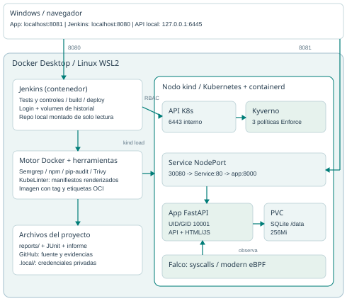

# Entregable 3 - DevSecOps

**Agustín Negreira | DevOps | Noviembre 2026**

Repositorio: https://github.com/AgustinNegreira/cafeteria-devsecops

## Resultado y alcance

Se extendió la aplicación Cafetería con controles de código, dependencias, imagen, admisión Kubernetes y ejecución. La entrega se implementó y probó en un laboratorio local kind sobre Docker Desktop/WSL2. No depende de permisos administrativos del cluster de la UCU.

La app sigue siendo FastAPI + SQLite, con HTML/JavaScript servido por el mismo proceso. Permite crear pedidos antes del corte del recreo y gestionar sus estados, productos agotados y ventas. Se conservaron estas funciones y se verificó persistencia en el PVC.

| Requisito | Evidencia en reports/ | Resultado real |
|---|---|---|
| npm audit | npm-audit.txt | Ejecutado; ENOLOCK y justificación N/A |
| SAST Semgrep | semgrep.txt / .json | 0 hallazgos, 0 errores |
| Dependencias Python | pip-audit.txt / .json | 0 vulnerabilidades conocidas |
| Imagen Trivy | trivyreport.txt / .json | 0 vulnerabilidades; 0 HIGH/CRITICAL |
| 3 políticas Kyverno | kyverno-validation.txt / .json | 4 rechazos y 1 aceptación comprobados |
| KubeLinter | kubelinter.txt | 0 errores en manifiestos de la app |
| Falco | falco-event.log | Shell detectada en pod; UID 10001 |
| Funcional / CI | pytest.xml / jenkins-build.json | 11 tests; pipeline SUCCESS |

Los nombres pedidos están en la carpeta `/reports` de la raíz del proyecto. Se conservan las salidas originales de herramientas y JSON complementarios, no solo esta síntesis. Los resultados corresponden a las reglas y bases disponibles al ejecutar; no son una garantía permanente de ausencia de fallas.

<!-- pagebreak -->

# Arquitectura del laboratorio

Docker Desktop ejecuta el controller Jenkins y el contenedor del nodo kind. Dentro del nodo corren Kubernetes, containerd, la aplicación, Kyverno y Falco. El sistema usa un único nodo y namespaces separados para aplicación e infraestructura.

Jenkins construye/analiza en Docker; `kind load` importa la imagen al containerd del nodo. La API consulta Kyverno antes de admitir pods. Falco observa syscalls del kernel Linux mediante modern eBPF y enriquece eventos con metadatos CRI.

Windows usa localhost:8081 para la app y localhost:8080 para Jenkins. Jenkins se conecta al nodo por la red Docker kind: API en 6443 y app en NodePort 30080. La API externa del laboratorio está en 127.0.0.1:6445. SQLite persiste en `/data`, sobre PVC local de 256Mi. No intervienen Docker Hub ni APISIX en este circuito.

<!-- pagebreak -->

# Seguridad del código y dependencias

## npm audit: ejecución y aplicabilidad

Se ejecutó `npm audit` con npm 11.19.1 y Node 24.22.2. La salida real fue ENOLOCK, código 1, porque no existen package.json ni package-lock.json. La aplicación es Python y su JavaScript no usa paquetes npm. El archivo npm-audit.txt conserva la salida y la justificación; no se afirma que npm haya encontrado cero vulnerabilidades ni se añadió un proyecto npm ficticio.

Como control de las dependencias efectivas, se ejecutó pip-audit 2.10.1 sobre requirements.lock. La línea base detectó 14 vulnerabilidades conocidas en Starlette 0.41.3; el lock productivo final produjo 0. Esta adaptación técnica deja explícita la salvedad respecto al requisito literal npm.

## Semgrep y correcciones

Se aplicó Semgrep 1.183.0, configuraciones p/default, p/security-audit y p/dockerfile, sobre app, Dockerfile y k8s/base. Línea base: 3 alertas. Resultado final: 0 hallazgos y 0 errores de herramienta.

| Alerta original | Corrección aplicada |
|---|---|
| missing-user en Dockerfile | USER 10001:10001 explícito |
| run-as-non-root en Deployment | runAsNonRoot y UID/GID 10001 |
| allow-privilege-escalation-no-securitycontext | SecurityContext explícito y allowPrivilegeEscalation false |

No quedaron alertas Semgrep aceptadas ni se agregaron supresiones nosemgrep. Se eliminó el PIN por defecto del código: el arranque exige CAFETERIA_PIN de al menos ocho caracteres y usa comparación compare_digest. Los tests usan un PIN aleatorio propio, no una credencial de la instalación.

FastAPI, Starlette, uvicorn y tzdata se actualizaron y se fijó el lock completo. Se retiró uvicorn[standard] porque la app usa polling y no necesita ese grupo de dependencias opcionales. Los 11 tests verifican reglas de negocio y rechazo del arranque sin un PIN adecuado; la prueba HTTP real verificó 25 respuestas y persistencia al reemplazar el pod.

<!-- pagebreak -->

# Seguridad de la imagen

Se analizó la imagen original agustinnegreira/cafeteria:2: 48 filas HIGH, 80 MEDIUM, 64 LOW y 6 UNKNOWN; 0 CRITICAL. Las 48 filas HIGH corresponden a 12 CVE distintos, listados a continuación. El detalle por paquete/versión está en trivy-baseline.json y su disposición en remediaciones.md.

| CVE HIGH original | Tratamiento |
|---|---|
| CVE-2025-62727 | Starlette actualizada a 1.10.0 |
| CVE-2026-48818 | Starlette actualizada a 1.10.0 |
| CVE-2026-54283 | Starlette actualizada a 1.10.0 |
| CVE-2025-69720 | Cambio de base y paquetes de ncurses |
| CVE-2026-119373 | Cambio de base y versión de SQLite |
| CVE-2026-16742 | Retiro de paquetes Debian systemd/udev |
| CVE-2026-54369 | Cambio de base y paquete libacl |
| CVE-2026-76642 | Retiro del conjunto util-linux anterior |
| CVE-2026-78408 | Retiro del conjunto util-linux anterior |
| CVE-2026-78409 | Retiro del conjunto util-linux anterior |
| CVE-2026-78410 | Retiro del conjunto util-linux anterior |
| CVE-2026-9538 | Retiro del paquete Debian perl-base |

Se reemplazó la base Debian por Python 3.12 sobre Alpine 3.23, fijada por digest, se actualizaron paquetes y dependencias y se retiraron pip/setuptools/ensurepip del runtime una vez instaladas las dependencias. El código es propiedad de root, pero el proceso corre como UID/GID 10001 y solo escribe en los volúmenes previstos.

Trivy 0.76.1 sobre **cafeteria:devsecops-build-5** produjo **0 vulnerabilidades conocidas**, incluidas 0 HIGH/CRITICAL. No hay CVE finales aceptados ni exclusiones .trivyignore. Esta afirmación cubre la imagen de la app; no es un resultado de Jenkins, Docker Desktop o de todas las imágenes del cluster.

Imagen analizada: `sha256:d1095636f7dd5e45d4ced6ded7c24fc0095e276b53bb033d322c5692e3c20d94`. Commit de fuente analizado: `fc2065aa66a714baaf76e33ca285b6011a53c66d`. Fecha UTC: 2026-11-04T11:57:28.930708+00:00. El JSON completo registra artefacto, paquetes y metadatos; security-summary.json agrega hashes de fuente para vincular la evidencia al contenido.

<!-- pagebreak -->

# Seguridad en Kubernetes

Kyverno 1.19.2, chart 3.9.2, aplica tres ClusterPolicy en modo Enforce a los pods del namespace cafeteria-devsecops. Los controladores y el sistema están en namespaces separados. No se permite una excepción root para la aplicación.

| Política | Condición requerida |
|---|---|
| cafeteria-no-latest | Tag explícito distinto de latest o digest; rechaza también imágenes sin tag |
| cafeteria-require-resources | Requests y limits de CPU/memoria en contenedores e initContainers |
| cafeteria-non-root | runAsNonRoot=true y runAsUser mayor que cero explícitos |

La validación intentó crear pods reales con `kubectl apply`. No se usó únicamente lint ni dry-run. Cada YAML negativo conserva las otras condiciones válidas para aislar el motivo del rechazo.

| Caso | Resultado observado |
|---|---|
| bad-latest.yaml | DENY por cafeteria-no-latest |
| bad-untagged.yaml | DENY por cafeteria-no-latest |
| bad-resources.yaml | DENY por cafeteria-require-resources |
| bad-root.yaml | DENY por cafeteria-non-root |
| good.yaml | ALLOW, Ready y UID 10001 |

El script verifica el código de salida, el mensaje denied y la política esperada. El control positivo comprueba que las políticas admiten una configuración válida. Las salidas completas están en kyverno-validation.txt y JSON.

KubeLinter 0.8.3 pasó de 3 errores de línea base a 0 sobre la configuración local renderizada: tag concreto, raíz de solo lectura y ejecución no-root. Los manifiestos de pruebas negativas se excluyen del despliegue analizado porque son entradas de prueba deliberadamente inválidas.

El Deployment define requests 50m/96Mi y limits 300m/256Mi, capacidades drop ALL, seccomp RuntimeDefault, allowPrivilegeEscalation false y automountServiceAccountToken false. El PVC y fsGroup 10001 permiten SQLite sin un initContainer root. La API ClusterPolicy sigue soportada en esta versión fijada, pero la documentación actual la marca obsoleta; futuras actualizaciones requieren revisar la migración a CEL.

<!-- pagebreak -->

# Seguridad en tiempo de ejecución

Se instaló Falco 0.45.2, chart 9.2.2, como DaemonSet en namespace falco. Utiliza modern_ebpf en el kernel WSL2 y el socket CRI de containerd del nodo. El sensor capturó eventos syscall reales; instalar el chart por sí solo no se consideró evidencia suficiente.

Se ejecutó `kubectl exec -it` para abrir `sh` en el pod de la app. Dentro se ejecutaron `id` y `exit`. La terminal corrió con UID/GID 10001 y Falco emitió la regla **Terminal shell in container**, prioridad Notice.

| Campo del evento conservado | Valor |
|---|---|
| Regla | Terminal shell in container |
| Fuente / prioridad | syscall / Notice |
| Hora UTC del evento | 2026-11-04T12:02:07.654549733Z |
| Namespace | cafeteria-devsecops |
| Pod | cafeteria-agustin-789b87dc85-p54vv |
| UID | 10001 |
| Proceso / TTY | sh / 34816 |

El evento completo, sin reconstruir ni inventar campos, está en falco-event.log. Su nombre de pod y namespace vinculan la captura a la aplicación del laboratorio. Los nombres de imagen enriquecidos por CRI pueden mostrar el alias de importación de kind; la identidad de la imagen analizada está en security-summary.json y el despliegue se registra en environment.json.

Esta demostración comprueba detección, no prevención de ejecución: Falco alerta de la shell, mientras Kyverno controla la admisión previa del pod. Ser usuario no-root reduce permisos pero no impide que una terminal sea una actividad a monitorear.

La prueba automatizada adicional creó un pedido, comprobó reglas y estados, eliminó únicamente el pod de la app y verificó el mismo pedido en el pod nuevo. application-smoke.json conserva la evidencia de persistencia y las 25 respuestas HTTP verificadas. El PVC conserva los datos frente al reemplazo del pod; borrar el cluster no es una prueba de persistencia del volumen.

<!-- pagebreak -->

# Pipeline y controles de acceso

El job cafeteria-devsecops ejecuta las etapas: tests, código/dependencias/manifiestos, build, Trivy, despliegue bajo Kyverno y verificación HTTP. Un resultado de herramienta fallido o HIGH/CRITICAL impide continuar al deploy. npm N/A se acepta únicamente bajo la comprobación explícita de ausencia de archivos npm y error correspondiente.

Build comprobado: **#5 - SUCCESS**. URL local: http://localhost:8080/job/cafeteria-devsecops/5/. Jenkins archiva los reportes y JUnit; jenkins-build.json y jenkins-console.txt conservan el resultado fuera del volumen del controller.

Jenkins lee el repo local montado de solo lectura por file:///proyecto y consulta su rama cada minuto. Los cambios deben tener commit para disparar el job. El push a GitHub entrega y respalda el código; el pipeline del laboratorio no depende de webhook ni requiere token Docker Hub.

| Control | Implementación |
|---|---|
| Acceso Jenkins | Usuario local agustin, contraseña aleatoria privada, sin lectura anónima; API anónima devolvió 403 |
| Exposición | Puertos web ligados a 127.0.0.1 |
| Credencial de despliegue | ServiceAccount jenkins-deployer, token 24 h, Role/RoleBinding del namespace |
| Permisos verificados | Puede actualizar deployments propios; no listar secretos ni operar en kube-system o crear políticas de cluster |
| Secretos fuera de entrega | .local/, jenkins/secrets/ y credenciales UCU ignorados; solo Secret references en manifiestos |
| Historial anterior | Controller legado detenido; su volumen se conserva |

El socket Docker otorga poder alto sobre el motor local aunque el usuario del controller no sea root. RBAC limita el uso directo de Kubernetes, pero no constituye aislamiento frente a un administrador malicioso de Docker. Se admite este alcance en un laboratorio de un único usuario; una plataforma multiusuario requeriría agentes/builders aislados.

Otros límites: SQLite y una réplica con Recreate generan un breve corte al actualizar; el alumno se identifica por nombre sin autenticación; el PIN es una protección de demo; el acceso web local usa HTTP en loopback. El cero de Trivy/Semgrep está acotado a herramientas, objetivos y fecha registrados, no a toda la infraestructura.

<!-- pagebreak -->

# Reproducción y entrega

La guía GUIA_ENTREGABLE_3.md desarrolla cada comando, resultados esperados, preparación y diagnóstico. Secuencia breve desde la raíz del repo en cmd:

1. Iniciar Docker Desktop; ejecutar Start-Lab.ps1 para herramientas, kind, charts, escaneos y app.
2. Ejecutar Start-Jenkins.ps1: arranque autenticado y renovación del token Kubernetes.
3. Abrir localhost:8081 y /cafeteria; crear un recreo futuro, pedir y cambiar estados.
4. Ejecutar Test-Kyverno.ps1: cuatro rechazos y un caso válido.
5. Con Jenkins sin desplegar, ejecutar Capture-Falco.ps1, escribir id y exit.
6. Abrir un build SUCCESS de Jenkins y sus artefactos; repetir con Build Now si se desea.
7. Ejecutar smoke.py --persistence y revisar la evidencia del pedido retenido.

Las rutas completas y comandos copiables están en la guía. Los secretos se generan en cada instalación: PIN en .local/cafeteria-pin.txt y clave Jenkins en .local/jenkins-admin-password.txt. No se distribuyen en el ZIP ni en GitHub. El token del ServiceAccount vence a las 24 h y se renueva volviendo a ejecutar Start-Jenkins.ps1.

## Versiones del laboratorio

| Herramienta | Versión |
|---|---|
| kind / Kubernetes / Helm | v0.33.0 / v1.35.8 / v4.3.1 |
| Kyverno / chart | 1.19.2 / 3.9.2 |
| Falco / chart | 0.45.2 / 9.2.2 |
| Semgrep / Trivy / KubeLinter | 1.183.0 / 0.76.1 / 0.8.3 |
| Jenkins / pip-audit | 2.580.1 / 2.10.1 |

## Referencias técnicas oficiales

- kind: https://kind.sigs.k8s.io/docs/user/quick-start/
- Kyverno: https://kyverno.io/docs/installation/installation/
- Falco modern eBPF: https://falco.org/docs/concepts/event-sources/kernel/
- Semgrep: https://docs.semgrep.dev/semgrep-code/overview
- Trivy: https://trivy.dev/docs/latest/target/container_image/
- KubeLinter: https://docs.kubelinter.io/

**Contenido de la entrega:** informe PDF, código/políticas/scripts, reportes íntegros y guía de demostración. Enlace verificado: https://github.com/AgustinNegreira/cafeteria-devsecops. Si el repositorio conserva visibilidad privada, el docente necesita acceso explícito.
