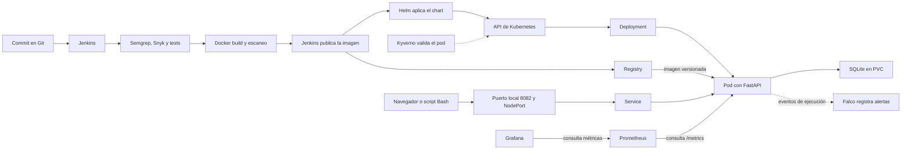

# Laboratorio 4 · Guía de trabajo y estudio

Para Agustín y Valentín · Actualizada el 17 de noviembre de 2026

Esta guía es el punto de partida de Codex para retomar qué tiene que explicarles a Agustín y Valentín y preparar con ellos la defensa presencial. La fuente de requisitos es la [consigna del Laboratorio 4](Laboratorio%204.pdf). La implementación usa [Cafetería](README.md), el proyecto existente del entregable 3. El punto de control al final registra qué se comprobó y qué queda por enseñar o ensayar.

## 1. Qué queremos lograr

Queremos poder partir de un cambio en Git, comprobar que funciona y pasa los controles de seguridad, empaquetarlo, publicar una imagen identificable y desplegarla automáticamente. Después queremos comprobar que los alumnos pueden hacer pedidos, ver el comportamiento del sistema bajo tráfico y detectar un evento de seguridad mientras corre. Al final, otra persona tiene que poder repetir la demo y limpiar el entorno siguiendo el README o informe.

El eje de la defensa es explicar cómo funcionan juntas las herramientas de DevOps y DevSecOps. Los pedidos de Cafetería aportan un caso para verificar el despliegue, comprobar la persistencia y generar tráfico para las métricas.

### Los dos recorridos que vamos a seguir



- **Recorrido del cambio.** Jenkins toma un commit y ejecuta los controles. Docker construye la imagen, el registry la distribuye y Helm actualiza los recursos que Kubernetes usa para ejecutarla. El Deployment mantiene los pods y Kyverno revisa su admisión.
- **Recorrido de un pedido.** El navegador entra por el puerto local 8082 y el Service NodePort dirige el tráfico al pod. FastAPI valida el pedido y lo guarda en SQLite. Prometheus consulta las métricas de la app y Grafana las grafica. Falco observa eventos de ejecución en el nodo.

## 2. De dónde partimos

| Parte | Lo que hay en Cafetería | Trabajo del Lab 4 |
| --- | --- | --- |
| Aplicación | FastAPI sirve la API y las pantallas HTML/JS en un proceso. SQLite guarda pedidos en un PVC. Hay tests con pytest. | Entender y conservar el flujo. Instrumentar las solicitudes y los pedidos creados. |
| Imagen | El Dockerfile de la app fija la imagen base por versión y digest, y corre con UID 10001. Usa una sola etapa. | Pasar a build multietapa y documentar el escaneo y la composición de la imagen. |
| Despliegue | El despliegue de la app usa manifiestos Kustomize. Helm ya se usa para instalar Kyverno y Falco en el laboratorio anterior. | Crear y probar un chart Helm para Cafetería. |
| Jenkins | Corre tests, Semgrep, pip-audit y Trivy, y carga la imagen al kind local. | Agregar Snyk para dependencias, publicar al registry, desplegar con Helm y verificar el bloqueo por críticos. |
| Observabilidad | La app tiene `/healthz` para verificar acceso a la base. | Agregar métricas, configurar Prometheus y exportar el dashboard de Grafana. |
| Kyverno | Tres políticas y cuatro casos negativos. `latest` y la imagen sin etiqueta prueban la misma política. | Llegar a cuatro políticas y demostrar un rechazo atribuible a cada una. |
| Falco | El Lab 3 registró una alerta por abrir una terminal en el pod. | Disparar y registrar otro tipo de evento. |
| Operación | Hay scripts PowerShell y guías del laboratorio local. | Preparar los scripts Bash y las evidencias reproducibles del Lab 4. |

Para preparar la explicación, abran las configuraciones del Lab 4 y el dashboard. [Dockerfile](Dockerfile) · [Chart de Helm](helm-chart) · [Jenkinsfile](Jenkinsfile) · [Políticas de Kyverno](security/kyverno) · [Dashboard de Grafana](grafana/dashboard.json)

## 3. Cómo estudiar las herramientas para la defensa

En cada bloque, partir de una herramienta y explicar qué problema resuelve, en qué momento actúa, qué recibe y qué produce. Abrir la configuración que usamos, ejecutar un comando o mostrar una salida real y practicar qué revisaríamos si falla. Alternar quién opera y quién responde como en la defensa.

### 1. Cafetería como caso de prueba

Presentar en una frase qué hace Cafetería. Usar un pedido y `/healthz` para comprobar el despliegue, recuperar el mismo pedido tras reemplazar el pod para mostrar el PVC, y generar solicitudes para que se vean cambios en Prometheus y Grafana. Los tests de horario y el pedido 1 ya registrado sirven como evidencia de esos flujos. [Prueba de persistencia](reports/lab4-persistencia.txt)

### 2. Docker y análisis de imagen

**Objetivo.** Explicar cómo el mismo artefacto que construye y analiza Jenkins llega al pod.

1. Mostrar la diferencia entre Dockerfile, imagen y contenedor. Abrir el Dockerfile y señalar la base fijada por versión y digest, la etapa `dependencies` y la etapa final `runtime`. Explicar por qué la etapa final copia la aplicación y las dependencias instaladas y ejecuta con UID 10001. [Dockerfile](Dockerfile)
2. Ubicar `docker build`, Trivy y `docker push` en Jenkins. Seguir la etiqueta del build 4 desde el log al registry. La etiqueta vincula el build con el commit y el digest permite comprobar el contenido exacto. [Jenkinsfile](Jenkinsfile) · [Build 4](http://localhost:8083/job/cafeteria-lab4/4/)
3. Mostrar qué se midió con Dive y qué se escaneó con Trivy. En PowerShell, inspeccionar la imagen publicada y comprobar el usuario efectivo.

```powershell
$imagen = 'localhost:5001/cafeteria:build-4-2d470a9191a6'
docker image inspect $imagen --format 'bytes={{.Size}} capas={{len .RootFS.Layers}} usuario={{.Config.User}}'
docker run --rm --entrypoint id $imagen -u
```

**Evidencia y pregunta.** La imagen tiene 9 capas, pesa 115.437.752 bytes y el contenedor devuelve UID 10001. ¿Qué aporta separar la instalación de dependencias de la etapa que corre en el pod? ¿Qué evidencia mostrarías si te preguntan por el tamaño o por vulnerabilidades? [Análisis con Dive](reports/image-analysis.md) · [Escaneo con Trivy](reports/trivyreport.txt)

### 3. Kubernetes y Helm

**Objetivo.** Poder reproducir el despliegue, configurar el entorno y conservar los pedidos al reemplazar un pod.

1. Traducir los manifiestos existentes a `helm-chart/`. Recorrer el Deployment, el Service, el ConfigMap, el Secret del PIN y el PVC. Parametrizar imagen, puertos, réplicas y recursos en `values.yaml` y agregar `values-dev.yaml` o `values-prod.yaml`. Definir Ingress si el entorno lo requiere.
2. Mostrar primero qué YAML renderiza Helm con `helm template`. Desde el repo de trabajo, probar el primer despliegue con `helm install <nombre> ./helm-chart`, usando el namespace del lab y los valores del entorno. Para actualizaciones, usar la misma release con `helm upgrade --install`.
3. Verificar pods listos, Service accesible y `/healthz`. Hacer un pedido, reemplazar el pod de prueba y consultar el pedido de nuevo. Partir de una réplica con SQLite y explicar cómo influye esa decisión en las actualizaciones.

**Evidencia y pregunta.** Guardar el resultado de Helm, el estado del rollout y la comprobación del pedido después del reemplazo. ¿Quién mantiene los pods, quién dirige el tráfico y qué recurso conserva la base?

### 4. Jenkins y los controles antes del despliegue

**Objetivo.** Hacer repetible el camino desde un commit hasta una release y cortar a tiempo si falla un control.

1. Dibujar Jenkins, el agente, el repositorio, el registry y el cluster. Leer el `Jenkinsfile` y ubicar las credenciales de Snyk, del registry y del cluster en la configuración de Jenkins.
2. Armar las etapas en este orden. Checkout del repo → Semgrep sobre el código con al menos dos reglas de seguridad aplicables a Python → Snyk sobre dependencias → build y tests de la app → build y escaneo de imagen → publicación → despliegue con Helm → verificación HTTP. Diferenciar el escaneo de dependencias del escaneo de la imagen.
3. Correr un build normal y seguir el mismo identificador desde Git hasta la imagen usada por el pod. Configurar y demostrar con un caso controlado que un hallazgo crítico detiene el pipeline antes de publicar o desplegar. Archivar resultados aunque falle el build.

**Evidencia y pregunta.** Guardar los logs por etapa, `reports/semgrep-report.txt` y `reports/snyk-report.txt`. En Semgrep, corregir o justificar los hallazgos. En Snyk, identificar los críticos encontrados y proponer correcciones. ¿En qué punto se corta el flujo si el problema está en una dependencia y cómo sabemos qué versión quedó corriendo?

### 5. Prometheus y Grafana

**Objetivo.** Poder relacionar lo que hacen los usuarios con lo que muestran las métricas.

1. Instrumentar `/metrics` con un contador de solicitudes, un histograma de duración y un contador de pedidos creados. Incrementar el contador de pedidos después de guardar con éxito. Evitar etiquetas con nombres de alumnos o IDs de pedidos.
2. Desplegar Prometheus en el cluster, configurar el scrape y confirmar que el target esté `UP`. Verificar de dónde llegan las series de CPU y memoria por pod. Conectar Grafana a Prometheus y construir los paneles.
3. Generar tráfico HTTP y pedidos válidos con datos de prueba. Controlar que exista un recreo abierto para la demo. Comparar las curvas antes, durante y después. Explicar que RPS es la tasa del contador de requests y que la latencia promedio sale de dividir las tasas de la suma de duraciones y de su cantidad de observaciones.

**Evidencia y pregunta.** Mostrar RPS, latencia promedio, CPU y memoria por pod, y pedidos creados. Exportar `grafana/dashboard.json`. Si los pedidos devuelven `409` por horario, ¿qué panel debería moverse y cuál debería seguir igual?

### 6. Kyverno y Falco

**Objetivo.** Separar la admisión en Kubernetes de la detección de eventos mientras un contenedor corre.

1. Instalar Kyverno. Aplicar en el namespace de la app las tres políticas base (versionado, límites de CPU y memoria, ejecución sin root). Agregar una cuarta, por ejemplo exigir `allowPrivilegeEscalation: false`. Preparar un pod válido y un caso aislado por política, para que el rechazo indique exactamente qué condición incumplió.
2. Instalar Falco y comprobar que recibe eventos del nodo. Usar un pod de demo aislado y disparar una regla con una acción directa que no abra un shell. Una opción para validar es una regla de demo que detecte la escritura de un archivo con nombre fijo en `/tmp`, invocando directamente el ejecutable que lo crea. Correlacionar regla, hora, namespace y pod en el registro.

**Evidencia y pregunta.** Guardar aceptaciones y rechazos en `reports/kyverno-validation.log` y el evento real con una breve descripción en `reports/falco-event.log`. ¿Qué pasó antes de crear el pod y qué pasó cuando el contenedor ya estaba corriendo?

### 7. Scripts, informe y defensa de punta a punta

**Objetivo.** Que cualquiera de los dos pueda levantar, demostrar y limpiar el lab siguiendo la guía.

1. Preparar Bash para inicializar el entorno, instalar los operadores de Kubernetes y levantar todos los componentes, incluido Jenkins. Documentar prerequisitos y la forma de suministrar credenciales. Probar los scripts en un entorno Bash, por ejemplo WSL.
2. Preparar Bash para generar tráfico y pedidos de demo, y para limpiar los recursos del lab. Usar un cluster o contexto de prueba definido para evitar tocar recursos de otros trabajos. Documentar qué pasa con el PVC y los datos durante la limpieza.
3. Repetir la demo desde un entorno limpio. Levantar el stack, correr el pipeline, confirmar la versión desplegada, crear un pedido, ver Grafana, provocar un rechazo de Kyverno y una alerta de Falco. Exportar la evidencia y limpiar el entorno.
4. Escribir el README o informe PDF con descripción, diagrama de arquitectura, etapas del pipeline, dashboard, resultados de seguridad, problemas y soluciones, conclusiones y oportunidades de mejora. Incluir los comandos paso a paso, sus salidas relevantes, capturas o fragmentos de logs y el dashboard JSON.

**Evidencia y pregunta.** Cada integrante repite una parte que operó el otro. Ante un fallo, ¿qué revisarían primero si Jenkins queda en rojo, el pod no inicia, el Service no responde o Grafana queda vacío?

## 4. Preparar la defensa en la laptop de Agustín

La presentación es presencial. Agustín y Valentín llevan el lab funcionando en la laptop de Agustín y muestran al docente el resultado y cómo llegaron a él. La secuencia empieza con un pedido breve como contexto y sigue el trabajo de DevOps desde el commit hasta el pod. Después muestra qué observamos en ejecución y qué controles de seguridad aplicamos. Conviene practicarla completa y poder saltar al archivo o a la salida que pida el docente.

### Qué dejar abierto antes de la presentación

- Navegador con Cafetería, el último build de Jenkins y Grafana. Dejar disponible el commit que corresponde a ese build.
- Terminal en el repositorio de Cafetería, apuntando al cluster de la demo. Tener listo el comando que comprueba los pods y la versión desplegada.
- Editor con el diagrama, `Jenkinsfile`, `Dockerfile`, `helm-chart/` y las políticas. Tener a mano `reports/` y el dashboard exportado para respaldar una explicación o mostrar una ejecución que lleve tiempo.
- Datos de prueba para un pedido válido y uno rechazado. Verificar de antemano el corte horario, la conectividad para Snyk y que el dashboard ya reciba datos.

### Guion para recorrer el trabajo frente al docente

| Momento | Qué mostrar en la laptop | Qué explicar en voz alta |
| --- | --- | --- |
| 1. Contexto de la demo | Pantalla de alumno y un pedido de prueba | Qué hace Cafetería y cómo usamos el pedido para comprobar la versión desplegada. |
| 2. Construcción y publicación | Commit, etapas del build, Dockerfile, reporte de Dive y etiqueta publicada | Qué separa el build multietapa, qué revisa cada escáner, cuándo Jenkins corta ante un crítico y cómo identifica la imagen publicada. |
| 3. El despliegue | El chart, los pods listos, la imagen en uso y el Service | Qué hace cada recurso. Cómo se verifica que quedó corriendo la imagen del build y por qué el pedido sobrevive al reemplazo del pod. |
| 4. Las métricas | Script de tráfico, target de Prometheus y paneles de Grafana | Qué mide cada gráfico y qué cambia si llegan muchos requests con pedidos rechazados. |
| 5. La seguridad | Un rechazo de Kyverno en vivo, evidencias de las cuatro políticas y un evento real de Falco | Qué controla Kubernetes antes de admitir un pod y qué evento detecta Falco cuando ya hay un contenedor corriendo. |
| 6. La reproducción | Scripts de arranque, tráfico y limpieza, y el informe técnico | Qué comandos permiten repetir el lab y dónde se encuentran las pruebas de que funcionó. |

En el ensayo, uno presenta y el otro hace de docente. Después intercambian. Cada integrante practica abrir una evidencia, explicar por qué está diseñada así y decir qué revisaría si no aparece el resultado esperado. Si un paso lleva tiempo durante la presentación, podemos recorrer la evidencia de una ejecución anterior e indicar cuándo se obtuvo.

### Preguntas para el ensayo

- ¿Qué evidencia aporta un pedido de prueba y qué verifica la respuesta de `/healthz`?
- ¿Qué diferencia hay entre un Dockerfile, una imagen y un contenedor? ¿Qué copia la etapa final y con qué usuario corre?
- ¿Qué hace Helm y qué hace Kubernetes? ¿Qué recurso pierde su IP al reemplazarse y qué recurso mantiene los datos?
- ¿Qué revisan Semgrep, Snyk y Trivy, y qué mide Dive? ¿En qué etapa corta Jenkins si Snyk detecta un crítico?
- ¿Cómo sabemos que un panel vacío se debe a falta de tráfico o a un problema en el scrape?
- ¿Por qué el rechazo de Kyverno y la alerta de Falco ocurren en momentos distintos?
- ¿Cómo sabés que el pedido que estás mostrando se sirvió desde la versión del build que abriste en Jenkins?

## 5. Instrucciones para Codex al retomar este chat o abrir otro

1. Leer esta guía y el último punto de control. Abrir los archivos que figuren en el bloque siguiente y verificar el estado del código y de las evidencias antes de describirlos como terminados.
2. Para cada bloque implementado, explicarle a Agustín qué problema resuelve, por qué se eligió esa solución, dónde está en el código, qué ocurre al ejecutarla y qué salida lo demuestra. Empezar por la responsabilidad de la herramienta en el flujo del lab. Usar un pedido cuando sirva para comprobar un resultado, como el despliegue, la persistencia o una métrica.
3. Hacer la explicación de a un bloque con un comando, una salida real y una pregunta de comprobación. Si todavía no hay una prueba ejecutada, identificar qué falta correr. Después practicar el paso tal como lo mostrarían en la laptop y una pregunta probable del docente.
4. Al cerrar un bloque, anotar acá lo implementado, qué se verificó con evidencia y qué explicación o ensayo queda pendiente. Un casillero de construcción marcado indica que la verificación indicada pasó. El ensayo se registra cuando Agustín o Valentín hayan explicado o mostrado el paso.
5. Antes de la defensa, ensayar la secuencia entera desde la laptop, con ambos integrantes, y comprobar que cada uno pueda explicar las decisiones y ubicar las pruebas.

## 6. Avance y próximo paso

- [x] Adoptar Cafetería como base. Trabajo en la rama local `laboratorio-4`, con cluster kind y registry propios de la laptop.
- [x] Reproducir los tests y el pedido aceptado y rechazado. Hay 12 tests en verde.
- [x] Construir y analizar la imagen multietapa. Dive pasó y el contenedor corre con UID 10001.
- [x] Publicar la imagen local, desplegar con Helm y comprobar que el pedido siga accesible tras reemplazar el pod.
- [x] Obtener en Prometheus las cinco series con tráfico real y confirmar los cinco paneles provisionados en Grafana.
- [x] Guardar cuatro rechazos de Kyverno y una alerta de Falco por `touch`.
- [x] Completar Jenkins y guardar el escaneo autenticado de Snyk. El build 4 terminó en `SUCCESS`, publicó la imagen y desplegó con Helm. [Consola del build](reports/lab4-jenkins-console.txt) · [Reporte de Snyk](reports/snyk-report.txt)
- [ ] Completar el repaso de ConfigMap y Secret, requests y limits, probes y la función del operador de Prometheus y ServiceMonitor.
- [ ] Recorrer los scripts Bash de arranque, tráfico y limpieza y explicar qué prepara cada uno.
- [ ] Ensayar en la laptop con los dos integrantes: pipeline, imagen desplegada, métricas con tráfico, rechazos de Kyverno y evento de Falco.
- [ ] Probar el ciclo operativo de arranque y limpieza con la instancia de ensayo y dejar preparado el entorno de la presentación.
- [x] Publicar el código, informe, evidencias, guía y consigna en la rama laboratorio-4 del repositorio. Publicación verificada el 17 de noviembre de 2026, commit 77adef5. [Rama compartida](https://github.com/AgustinNegreira/cafeteria-devsecops/tree/laboratorio-4)

El [informe técnico](LABORATORIO_4.md) reúne los comandos y las evidencias actuales.

### Punto de control para Codex

Ya recorrimos Docker y Dive y empezamos Kubernetes. Agustín explicó que Kubernetes debe recrear el pod para mantener la réplica deseada. Revisamos que el Deployment crea el ReplicaSet, que el pod declara sus volúmenes y que `/data` usa un PVC respaldado por almacenamiento local del nodo kind. El 12 de noviembre reemplazamos en vivo el pod `cafeteria-6d58c9d5f6-czlmx` (10.244.0.11) por `cafeteria-6d58c9d5f6-j44ss` (10.244.0.15). El PVC, el PV y el pedido 23 se conservaron. Agustín explicó el acceso estable del Service y su capacidad de distribuir conexiones entre pods listos. Ya vimos su selección por etiquetas y el acceso de la laptop por NodePort. Ya vimos la estructura del chart, values.yaml y values-dev.yaml, la prioridad de -f y --set, y la diferencia entre renderizar e instalar o actualizar una release. Agustín identificó helm upgrade como el paso de actualización y repasamos que los parámetros de instalación se cambian en los archivos de valores. Agustín distinguió correctamente que un nuevo build desplegado conserva la versión del chart, incrementa la revisión de la release y cambia la etiqueta de la imagen. Seguimos con Jenkins como coordinador de CI/CD, el Jenkinsfile versionado, el checkout de la rama local y las etapas que validan, construyen, publican y despliegan. Agustín respondió que un fallo de pytest impide llegar a las etapas posteriores. Repasamos que el bloque post/always conserva los reportes incluso ante fallos. Empezamos DevSecOps con Semgrep: análisis del código fuente, las dos reglas de Python, el reporte de hallazgos y el código de salida que corta Jenkins. Agustín identificó Semgrep como el control que falla ante un patrón prohibido. Precisar que post/always archiva y que la evidencia se abre en los artefactos del build, en reports/semgrep-report.txt, o en la consola de la etapa. Seguimos con Snyk sobre requirements.lock y el entorno instalado: dependencias directas y transitivas, comparación con vulnerabilidades conocidas, credencial de Jenkins y reporte. Agustín identificó Snyk como el control que bloquea una dependencia crítica y su reporte como evidencia. Seguimos con Trivy sobre la imagen Docker construida: paquetes del sistema base y bibliotecas incluidas, ejecución después del build y antes de publicar, y bloqueo configurado para HIGH/CRITICAL. Repasamos con FastAPI y zlib que Snyk revisa las dependencias Python declaradas en requirements.lock y Trivy revisa la imagen construida, incluidos paquetes Python y del sistema Alpine. Hay cobertura superpuesta. Un import por sí solo no determina el alcance del escaneo. Agustín confirmó que comprendió esa diferencia. Seguimos con Kyverno instalado en el cluster mediante Helm, políticas Enforce sobre la configuración y evidencia de cuatro rechazos en reports/kyverno-validation.log. Agustín identificó que la admisión pasa por la API y Kyverno también revisa una solicitud manual de kubectl. Seguimos con Falco en ejecución: observa eventos del nodo y genera alertas según reglas. La demo usa una regla propia que detecta la apertura para escritura de /tmp/lab4-falco-event, disparada con touch directo en el pod de prueba; la evidencia está en reports/falco-event.log. Agustín ubicó correctamente Kyverno en la admisión y Falco durante la ejecución. Seguimos con Prometheus y Grafana: la app expone contadores e histograma en /metrics; ServiceMonitor configura el scrape cada 10 segundos; Prometheus recolecta y guarda mediciones y Grafana consulta sus series para los cinco paneles. CPU y memoria provienen de las métricas del nodo. Agustín preguntó por qué usar Prometheus si Grafana puede consultar un endpoint. Para explicarlo, usar un ejemplo concreto: el contador vale 100 en una consulta y 130 diez segundos después; con las muestras guardadas se calcula un promedio de 3 peticiones por segundo. Grafana puede consultar APIs con un plugin compatible. En nuestro lab Prometheus recolecta periódicamente y guarda el historial que Grafana consulta por intervalos de tiempo. Ambos se desplegaron mediante Helm como pods del namespace monitoring dentro del cluster kind de la laptop. Para explicar el hosting en producción, usar servidores o Kubernetes administrados por la empresa y servicios gestionados como alternativas posibles. En monitoring/values.yaml se configuró retención de 1 día y se dejó el almacenamiento predeterminado del operador, sin un PVC de métricas configurado; distinguir esa retención del tiempo de vida del volumen. La explicación general de las herramientas está recorrida. Repasamos ConfigMap y Secret y cómo el Deployment inyecta sus valores como variables de entorno. Agustín pidió comparar con el caso sin ConfigMap: se pueden definir las variables directamente en el Deployment y reutilizar la misma imagen. El aporte propio del ConfigMap es separar y compartir configuración entre recursos; en nuestra app pequeña su beneficio organizativo es limitado y la consigna lo exige. Base64 es reversible y la protección de Secrets depende de permisos y cifrado configurados. Para explicar utilidad, empezar por un caso concreto sin la herramienta y mostrar qué cambia al incorporarla. Vimos requests y limits por contenedor con los valores de desarrollo: 50m/64Mi solicitados y 250m/192Mi como límites. Agustín resumió la diferencia; precisar que requests intervienen en la planificación y en el reparto de CPU bajo competencia, durante la vida del contenedor. Seguimos con probes ejecutadas por kubelet: startup durante el arranque, readiness para recibir tráfico del Service y liveness para reiniciar el contenedor ante fallas repetidas. En Cafetería las tres consultan /healthz, que verifica SQLite con SELECT 1. Aclaramos la arquitectura de ejecución: las probes son nativas y las ejecuta kubelet, el agente de cada nodo. kind ejecuta Kubernetes real con nodos que son contenedores Docker; nuestro cluster tiene un solo nodo que reúne control plane y cargas de trabajo. Docker Desktop ejecuta por separado jenkins-lab4, cafeteria-lab4-registry y cafeteria-lab4-control-plane. Dentro del nodo, containerd ejecuta los contenedores de los pods: Cafetería (una app con interfaz y API, SQLite en PVC), Prometheus, Grafana, sus auxiliares, Kyverno, Falco y componentes del sistema. Repasar dos flujos: Jenkins construye con el motor Docker de la laptop, publica en el registry y usa Helm contra la API de Kubernetes; el nodo descarga la imagen y ejecuta la app. Navegador localhost:8082 -> NodePort 30081 -> Service -> app:8000; Prometheus consulta /metrics y Grafana consulta Prometheus. La consigna exige Kubernetes, no kind: elegimos kind por el entorno local reproducible; Minikube cumple un propósito similar. Comparar con producción: mismos objetos y mecanismos de Kubernetes, nodos usualmente en máquinas virtuales o físicas independientes, con red, registro y almacenamiento apropiados para ese entorno. Nuestro único nodo y toda la laptop son un punto común de falla. No presentar kind como una simulación de la API ni al laboratorio como equivalente a alta disponibilidad de producción. Después seguir con operador/ServiceMonitor. Después recorrer los scripts y realizar una presentación completa desde la laptop, con generación de tráfico y consulta de las evidencias. La construcción ya tiene un pipeline completo verificado; falta el ensayo operativo y preparar la entrega final. [Service](helm-chart/templates/service.yaml)

En los bloques de Kubernetes y observabilidad, volver al pedido para comprobar el PVC y explicar las métricas. El contador de pedidos vive en el proceso y vuelve a cero cuando arranca otro pod. El pedido vive en SQLite y se conserva en el PVC. Para la defensa, practicar esa diferencia con los datos reales. [Análisis de imagen](reports/image-analysis.md) · [Captura de Prometheus](reports/lab4-prometheus.json)

La implementación está verificada con el build 4. Para estudiar Jenkins, abrir ese build y seguir el commit, la etiqueta y el digest hasta el pod. En el ensayo, cada integrante muestra el recorrido y contesta preguntas sobre una parte que operó el otro.

### Repaso de arquitectura y consumo (17/11/2026)

- El nodo kind es el contenedor Docker que actúa como máquina del cluster. Jenkins y el registry son contenedores independientes, externos a Kubernetes; compartir la red Docker kind no los convierte en nodos ni pods del cluster.
- Las políticas YAML de Kyverno son configuración. Los controladores de Kyverno, instalados como pods (cuatro en nuestro lab), son el software que las interpreta y evalúa. La API consulta al controlador de admisión para aceptar o rechazar solicitudes según las políticas.
- kube-apiserver es un programa servidor que expone la API de administración de Kubernetes y corre en su propio pod. El nodo es el entorno que lo aloja junto con otros componentes; API server no significa máquina que contiene todos los pods. Distinguir la API de Kubernetes de la API de pedidos de Cafetería.
- Para recordar la utilidad de Helm, comparar manifiestos aplicados con kubectl (también permite aplicar un directorio entero) con un chart que genera esos manifiestos usando valores de entorno y gestiona una release con revisiones y rollback. En nuestro pipeline cambiamos image.tag y ejecutamos helm upgrade --install para actualizar la instalación de Cafetería. Helm no mantiene los pods en ejecución; Kubernetes sí.
- Se verificó consumo antes de detener: nodo Lab 4 aproximadamente 3,2 GiB, nodo anterior 1,45 GiB y Jenkins anterior 0,75 GiB. Por pedido de Agustín se detuvieron jenkins-devsecops y cafeteria-devsecops-control-plane; no se borraron contenedores ni datos. Jenkins y registry del Lab 4 ya estaban detenidos y se mantuvieron así para reducir consumo durante el repaso. Para estudiar la app, probes, monitoreo y seguridad alcanza el nodo Lab 4; para probar el pipeline completo se necesitan también Jenkins y registry. Al arrancar Jenkins usar el script del lab para renovar su credencial de Kubernetes de 24 horas.

Retomar el operador de Prometheus y ServiceMonitor después de resolver las dudas de este repaso. Mantener el enfoque de utilidad concreta de cada herramienta y comprobar que Agustín puede distinguir máquina/nodo, proceso servidor, pod, contenedor y reglas de configuración.

Al revisar el consumo apareció además un problema real en los auxiliares reports/background de Kyverno: reinicios y CPU alta. Se ajustaron sus recursos en local/kyverno-values.yaml y se aplicaron con Helm (misma versión de chart, nueva revisión 2 de la release). Los cuatro controladores quedaron listos, los nuevos pods sin reinicios durante la verificación y las cuatro políticas siguieron bloqueando los casos inválidos en dry-run. El nodo quedó consumiendo aproximadamente 3,5 GiB y 20 % de CPU en la última medición puntual. [Evidencia del ajuste](reports/kyverno-resource-tuning.md). Para explicar Helm, este es ahora un ejemplo real adicional de actualizar configuración de una herramienta ya instalada.


### Prioridad actual: ensayo práctico de la defensa (17/11/2026)

Agustín pidió suspender el estudio teórico y pasar a probar y mostrar todo de punta a punta. Retomar por [GUIA_DEMO_LAB4.md](GUIA_DEMO_LAB4.md): comandos, resultados esperados y explicación breve para cada herramienta. Los tres contenedores necesarios están activos, los anteriores detenidos. Se incorporó b3ea5ef de Valentín; build 6 del commit 799eb0d terminó SUCCESS con 13 tests. Se verificaron el dashboard de siete paneles, tráfico 201/409, cambio de estado, persistencia del pedido 32 al reemplazar el pod, cuatro rechazos de Kyverno y alerta de Falco con touch. Detalles en [ensayo actual](reports/lab4-demo-2026-11-17.md). Las credenciales están en el archivo local ignorado .local/lab4/accesos-demo.txt. Falta que Agustín y Valentín recorran la guía en su presentación; responder dudas concretas sobre el paso donde estén, sin volver a un temario largo. La regla de Falco usada está en cafeteria/local/falco-lab4-values.yaml, customRules.lab4-demo.yaml.
