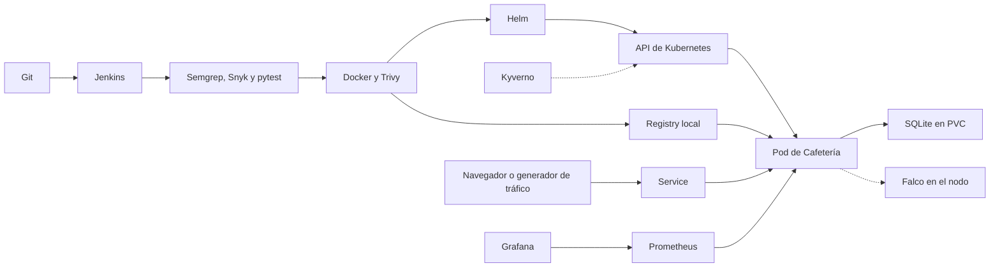

# Cafetería · Laboratorio 4

Agustín y Valentín · Trabajo integrador de DevOps y DevSecOps

Cafetería recibe pedidos de alumnos antes del corte de un recreo y permite que el personal actualice su estado. FastAPI sirve la API y las pantallas desde una imagen. SQLite guarda los pedidos en un volumen persistente. El lab conecta cada versión de Git con los controles de Jenkins, su imagen en el registry, el despliegue con Helm y la observación del servicio en Kubernetes.



## Preparar el entorno

En esta laptop el motor Linux de Docker Desktop ejecuta un cluster kind dedicado. Git Bash ejecuta los scripts. También hacen falta Git, Python 3, curl, OpenSSL y los binarios kind, kubectl y Helm. Los scripts agregan `.local/bin` al PATH. Si faltan los binarios en Windows, desde la carpeta de Cafetería se pueden instalar con el instalador ya incluido. La primera instalación descarga imágenes y charts.

```powershell
powershell -NoProfile -ExecutionPolicy Bypass -File scripts/local/Install-Tools.ps1
```

En Git Bash, desde la raíz del repo y en la rama `laboratorio-4`:

```bash
bash scripts/lab4/start.sh
```

El arranque prepara el cluster y el registry local `localhost:5001`, instala Kyverno, Falco y el stack Prometheus/Grafana con su operador, y arranca Jenkins. Si se abre el lab desde un clon nuevo, se puede construir y publicar la primera imagen de forma manual.

```bash
docker build -t cafeteria:lab4-dev-1 .
docker tag cafeteria:lab4-dev-1 localhost:5001/cafeteria:lab4-dev-1
docker push localhost:5001/cafeteria:lab4-dev-1

export PATH="$PWD/.local/bin:$PATH"
helm lint ./helm-chart -f helm-chart/values-dev.yaml
helm install cafeteria ./helm-chart \
  --kubeconfig .local/lab4/kubeconfig.yaml -n cafeteria-lab4 \
  -f helm-chart/values-dev.yaml --set-string image.tag=lab4-dev-1 --wait
kubectl --kubeconfig .local/lab4/kubeconfig.yaml -n cafeteria-lab4 get pods,svc,pvc
curl -fsS http://localhost:8082/healthz
```

Si la release ya está instalada, actualizarla con `bash scripts/lab4/deploy.sh lab4-dev-1` o ejecutar el pipeline. El chart usa una réplica y estrategia `Recreate` para el archivo SQLite en el PVC. El puerto de la app llega al host mediante el Service NodePort y el mapeo de kind. El PIN vive en un Secret inicializado con un archivo local ignorado por Git.

## Mostrar un pedido y verificar persistencia

```bash
bash scripts/lab4/traffic.sh --count 40 --delay 1
```

El script usa un recreo abierto y un producto disponible. Si encuentra un recreo cerrado, también muestra el rechazo. Para el ensayo conviene preparar ambos estados. En esta laptop se obtuvo `201` para el pedido 1 y `409` para el recreo de las 10:00, cuyo corte era a las 09:45.

```bash
kubectl --kubeconfig .local/lab4/kubeconfig.yaml -n cafeteria-lab4 \
  delete pod -l app.kubernetes.io/instance=cafeteria --timeout=180s
kubectl --kubeconfig .local/lab4/kubeconfig.yaml -n cafeteria-lab4 \
  rollout status deployment/cafeteria --timeout=120s
bash scripts/lab4/traffic.sh --verify-persistence
```

## Jenkins y análisis de seguridad

Jenkins queda en `http://localhost:8083`. El usuario es `agustin` y la contraseña de esta instalación vive en `.local/lab4/jenkins-admin-password.txt`. El job `cafeteria-lab4` clona la rama local desde el repositorio montado en modo de solo lectura. Los cambios que se quieren mostrar desde Jenkins tienen que estar en un commit. Para Snyk, colocar una credencial válida en `.local/lab4/snyk-token.txt` y ejecutar `bash scripts/lab4/start-jenkins.sh` para volver a cargarla y renovar el token Kubernetes de 24 horas. [Autenticación del CLI de Snyk](https://docs.snyk.io/developer-tools/snyk-cli/authenticate-to-use-the-cli)

| Etapa | Qué comprobar |
| --- | --- |
| Checkout | Commit y etiqueta que identifica el build. |
| Semgrep | Dos reglas de Python en `security/semgrep-python.yaml` y reporte en `reports/semgrep-report.txt`. |
| Snyk | Dependencias bloqueadas por versión, reporte `reports/snyk-report.txt` y corte si hay un crítico o falla el escaneo. |
| Build y tests | Compilación de Python y reporte JUnit de pytest. |
| Imagen y Trivy | Imagen multietapa y análisis de vulnerabilidades de paquetes del sistema y de la app. |
| Publicar | Imagen con etiqueta del build y commit en `localhost:5001`. |
| Desplegar con Helm | Rollout en `cafeteria-lab4`, imagen actualizada y `/healthz` correcto. |

El acceso de Jenkins a Kubernetes usa una ServiceAccount limitada al namespace de la app. Helm usa Secrets de ese namespace para almacenar las revisiones de la release. El acceso al socket Docker le permite al agente construir y publicar desde el motor de la laptop. Este diseño corresponde al entorno local del laboratorio.

El [análisis de imagen](reports/image-analysis.md) contiene tamaño, capas y resultados de Dive. Para reproducir los dos análisis locales:

```bash
python -X utf8 scripts/security/scan.py --image cafeteria:lab4-dev-1 --checks lab4-semgrep,trivy
bash scripts/lab4/validate-security.sh
```

Kyverno aceptó el pod válido y rechazó cuatro manifiestos, uno por política. Falco registró la apertura de `/tmp/lab4-falco-event` para escritura por `touch` ejecutado directamente en un contenedor con UID 10001. La primera prueba es de admisión y la segunda sucede en ejecución. [Validaciones de Kyverno](reports/kyverno-validation.log) · [Evento de Falco](reports/falco-event.log)

## Grafana y Prometheus

Abrir estos comandos en dos terminales y dejar que mantengan los túneles durante la presentación.

```bash
kubectl --kubeconfig .local/lab4/kubeconfig.yaml -n monitoring port-forward svc/lab4-grafana 3001:80
kubectl --kubeconfig .local/lab4/kubeconfig.yaml -n monitoring port-forward svc/lab4-monitoring-prometheus 9091:9090
```

Grafana queda en `http://localhost:3001`. El usuario inicial es `admin`. Consultar su contraseña en una terminal privada con `kubectl --kubeconfig .local/lab4/kubeconfig.yaml -n monitoring get secret lab4-grafana -o jsonpath='{.data.admin-password}' | base64 -d`. Prometheus queda en `http://localhost:9091`. En Targets, buscar el scrape de Cafetería y comprobar que esté `UP`.

El [dashboard exportable](grafana/dashboard.json) tiene siete paneles: incluye además estados de pedidos del día y pedidos entregados, incorporados por Valentín. RPS toma la tasa de solicitudes. La latencia promedio divide la tasa de segundos acumulados por la tasa de observaciones. CPU y memoria por pod llegan desde las métricas del nodo. Pedidos creados sube después de guardar un pedido exitoso. Durante la demo, correr el generador de tráfico y dejar que pasen varios scrapes.

## Limpiar el laboratorio

```bash
bash scripts/lab4/cleanup.sh
```

Este comando borra el cluster `cafeteria-lab4` y sus volúmenes de aplicación, la instancia y el volumen de Jenkins del Lab 4, y el registry local con sus imágenes publicadas. Los archivos del repo, la evidencia y las imágenes en caché del motor Docker quedan disponibles. Usar el comando cuando termine la presentación.

## Resultados y trabajo pendiente

El [ensayo del 17 de noviembre](reports/lab4-demo-2026-11-17.md) verificó el build 6 con 13 tests, el dashboard actualizado, persistencia y seguridad. Para repetirlo, seguir [GUIA_DEMO_LAB4.md](GUIA_DEMO_LAB4.md). Los resultados históricos siguientes conservan las versiones y fechas originales.

- Pytest pasó 12 tests. El nuevo test distingue un pedido persistido de un `409` y comprueba el contador HTTP y el histograma. [Reporte JUnit](reports/lab4-pytest.xml)
- La imagen multietapa pasó Dive y arrancó como UID 10001. La imagen se publicó en el registry local y Helm completó el rollout. También se probó `helm install` con una release temporal y se retiró esa release.
- El pedido 1 se recuperó después de que Kubernetes reemplazó el pod. [Prueba de persistencia](reports/lab4-persistencia.txt)
- Prometheus encontró el target de Cafetería en estado `UP`. Se observaron las cinco series con tráfico de prueba. Grafana cargó el dashboard con cinco paneles. [Captura de métricas](reports/lab4-prometheus.json)
- Semgrep ejecutó las dos reglas y reportó cero hallazgos. Trivy reportó cero vulnerabilidades en la imagen probada. Kyverno y Falco generaron las evidencias enlazadas arriba. [Semgrep](reports/semgrep-report.txt) · [Trivy](reports/trivyreport.txt)
- El build 4 de Jenkins terminó en `SUCCESS`. Snyk analizó 16 dependencias y encontró cero vulnerabilidades conocidas. La prueba del filtro con respuestas sintéticas verificó el bloqueo ante un crítico y ante un error de escaneo. [Build 4](http://localhost:8083/job/cafeteria-lab4/4/) · [Consola de Jenkins](reports/lab4-jenkins-console.txt) · [Reporte de Snyk](reports/snyk-report.txt) · [Pruebas del filtro](reports/lab4-snyk-gate-test.txt)
- Jenkins publicó `localhost:5001/cafeteria:build-4-2d470a9191a6` desde el commit `2d470a9191a61aae1e36da6060c8c27fcbb768e2`. El registry y el pod reportaron el mismo digest `sha256:0b3e008ed3141137ca8795963b1855d05e1d110cf0399dbc65221341891d9a8f`. Después del rollout con Helm, `/healthz` devolvió `ok` y el pedido 23 seguía disponible.
- Se revisó la sintaxis de los scripts Bash. La limpieza y el ensayo completo quedan para cuando se termine de usar esta instancia de prueba.

La revisión de la imagen muestra dónde se puede reducir duplicación de capas. SQLite permite una demo reproducible con una réplica. Si el proyecto necesitara escalar la escritura entre nodos, habría que revisar el almacenamiento y el modo de actualización del Deployment.
