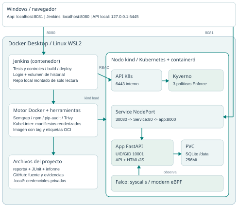

# Arquitectura local implementada - Entregable 3

Actualizado: 04/11/2026. Laboratorio creado y probado; ver las evidencias de `reports/`. El relevamiento inicial se conserva en `reports/preflight-local.txt` y describe la laptop antes de instalar, no el estado actual.

## Componentes y flujos

| Componente | Dónde corre | Función y conexiones |
|---|---|---|
| Navegador | Windows | Alumno y cafetería por localhost:8081; Jenkins autenticado por localhost:8080 |
| Docker Desktop | Linux sobre WSL2 | Motor que ejecuta Jenkins, herramientas efímeras y el contenedor del nodo kind |
| Jenkins | Contenedor `jenkins-devsecops` | Lee Git local, ejecuta tests, escáneres, build y deploy; volumen propio de historial |
| Herramientas de análisis | Contenedores efímeros / ejecutable KubeLinter | Reciben solo fuentes seleccionadas; exportan reportes. Trivy usa el socket del motor para analizar la imagen local |
| Nodo kind | Contenedor `cafeteria-devsecops-control-plane` | API Kubernetes, etcd, scheduler, kubelet y runtime containerd; un único nodo |
| Kubernetes API | Nodo, 6443 interno / 6445 loopback externo | Admite objetos con validación Kyverno y ejecuta workloads |
| Kyverno | Namespace `kyverno` | Tres ClusterPolicy Enforce para pods de `cafeteria-devsecops`; controladores con una réplica |
| App | Pod del Deployment `cafeteria-agustin` | FastAPI/uvicorn:8000, HTML/JS servido por el mismo proceso, UID/GID 10001 |
| Service | Namespace app, NodePort 30080 | Windows8081 -> nodo30080 -> Service80 -> pod8000 |
| ConfigMap | Namespace app | Zona horaria y corte inicial; el corte vigente se persiste en SQLite |
| Secret | Namespace app | PIN inyectado al proceso mediante env; no está en la imagen/Git |
| PVC | `cafeteria-agustin-data`, StorageClass standard | SQLite en `/data/cafeteria.db`; 256Mi, una réplica, Recreate |
| emptyDir | Pod app | `/tmp` temporal, con límite 16Mi; raíz restante de solo lectura |
| Falco | DaemonSet, namespace `falco` | modern eBPF observa syscalls del kernel Linux; metadatos por socket CRI de containerd |
| GitHub | Repositorio del alumno | Fuente entregable y evidencias; el polling de Jenkins usa el checkout local |

No se requiere registry remoto en este flujo: `docker build` crea la imagen en el motor Docker y `kind load docker-image` la importa al containerd del nodo. Docker y containerd son almacenes distintos, por eso existe ese paso. APISIX y la configuración UCU pertenecen al trabajo anterior y no intervienen en la entrega local.

## Límites de confianza y credenciales

El host usa `.local/kubeconfig.yaml` para administrar exclusivamente el cluster local. Jenkins recibe un kubeconfig interno con ServiceAccount `jenkins-deployer`, token de 24 h y Role del namespace de la app; el script de arranque lo renueva. Puede gestionar deployments/services/configmaps/PVC, observar pods/replicasets y leer únicamente el Secret nombrado de la app. No puede listar secretos ni gestionar políticas o recursos de otros namespaces mediante esa credencial.

Jenkins requiere login; no permite lectura anónima y publica el puerto solo en 127.0.0.1. Su socket Docker conserva un privilegio alto sobre el motor local: la restricción RBAC reduce permisos de Kubernetes pero no impide que un administrador de Docker controle el host del motor. Se trata de un laboratorio de un único usuario de confianza. Para uso multiusuario se necesitan agentes de construcción aislados y un diseño de credenciales diferente.

Las políticas se limitan al namespace de la aplicación. La infraestructura se instala desde el host; Falco precisa privilegios de observación del kernel incompatibles con imponerle el perfil del contenedor de negocio. Esta separación es explícita, no una excepción para que la app corra como root.

## Versiones verificadas

kind v0.33.0; Kubernetes v1.35.8; Helm v4.3.1; Kyverno 1.19.2 (chart 3.9.2); Falco 0.45.2 (chart 9.2.2); Semgrep 1.183.0; Trivy 0.76.1; KubeLinter 0.8.3; pip-audit 2.10.1; Jenkins 2.580.1.

La matriz de compatibilidad consultada admite Kubernetes 1.35 con Kyverno 1.19. Se utiliza ClusterPolicy, API soportada en la versión fijada pero marcada como obsoleta en la documentación actual; una actualización futura debe contemplar la migración a políticas CEL.

## Alcance de persistencia y disponibilidad

SQLite y una sola réplica mantienen simple la app; Recreate evita dos pods escribiendo al mismo archivo. Al actualizar/reemplazar el pod existe un breve corte. El PVC conserva datos frente a reemplazos, como demuestra `application-smoke.json`. Borrar kind puede borrar también el almacenamiento local: no se presenta como respaldo ni como infraestructura de producción.

El loopback permite mostrar todo desde esta laptop. Otro equipo o celular no accede directamente a `localhost` de la laptop. El laboratorio consume recursos mientras Docker/WSL, Jenkins y el nodo están encendidos; los scripts no cambian la configuración global de RAM/CPU de WSL.
